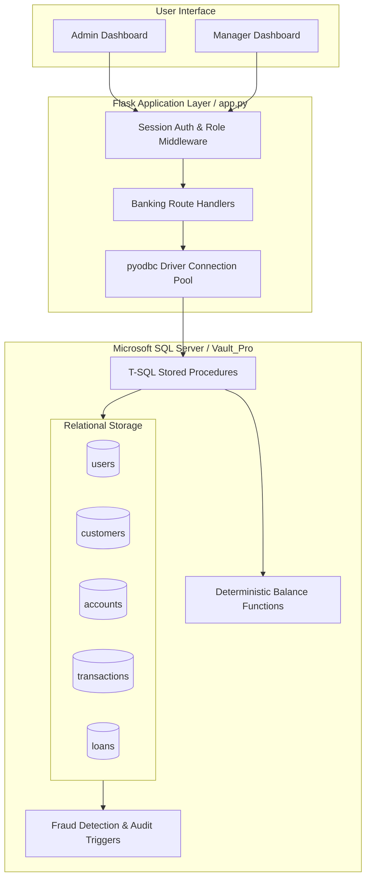

<div align="center">

# VaultManager Pro

### Enterprise core banking management system built with Python Flask and Microsoft SQL Server, featuring stored-procedure authentication, automated risk-based loan approval tiers, and trigger-based fraud detection.

[](https://www.python.org/)
[](https://flask.palletsprojects.com/)
[](https://www.microsoft.com/sql-server)
[](#)
[](#)

[**Features**](#features) · [**System Architecture**](#system-architecture) · [**Database Design**](#database-schema--logic) · [**Setup Guide**](#installation--setup) · [**Workflows**](#automated-workflows)

</div>

---

## Overview

Core banking systems demand absolute transactional integrity, deterministic audit logs, and strict boundary separation between frontline managers and executive administrators.

**VaultManager Pro** is a relational banking application connecting a lightweight Python Flask backend directly to **Microsoft SQL Server**. Business rules—including credential validation, cross-account balance transfers, loan risk evaluation, and anomaly triggers—are enforced at the database layer via pre-compiled T-SQL stored procedures, functions, and triggers to guarantee consistency and concurrency protection.

---

## System Architecture



---

## Features

### Role-Based Authorization
- **Administrator Role:** High-level institutional oversight, account freezing/unfreezing, loan state transitions, system-wide transaction auditing, and monthly repayment execution.
- **Manager Role:** Frontline customer onboarding, multi-tier account creation (Checking, Savings), fund deposits/withdrawals, peer-to-peer account transfers, and customer loan origination.

### Automated Workflows

#### 1. Algorithmic Loan Risk Evaluation
When a manager submits a loan application, the database evaluates the applicant's existing liquidity ratio and automatically assigns approval status and risk-adjusted interest rates:

| Customer Liquidity Ratio | System Decision | Assigned APR |
|---|:---:|:---:|
| **Balance $\ge$ 50% of requested loan** | Auto-Approved | **4.5%** |
| **Balance between 10% and 49% of loan** | Auto-Approved | **8.5%** |
| **Balance $<$ 10% of requested loan** | Rejected (High Risk) | N/A |

#### 2. Trigger-Based Fraud & Anomaly Detection
The transaction pipeline incorporates automated T-SQL triggers (`tr_fraud_detection`) that intercept suspicious withdrawals and abort transactions:
- Intercepts withdrawals exceeding \$10,000 threshold.
- Flags and halts withdrawals that completely liquidate account reserves to zero.
- Aborts unauthorized actions and bubbles descriptive error messages back to the Flask interface.

#### 3. Automated End-of-Month (EOM) Processing
- Aggregates all active `Auto-Approved` loans.
- Calculates installment payments: $\text{Installment} = \frac{\text{Principal}}{\text{Duration (Months)}}$.
- Automatically deducts repayments from the customer's oldest active account with sufficient balance.
- Dynamically flags loans as `Defaulted` if insufficient funds exist across all customer accounts.

---

## Database Schema & Logic

All schema definitions, relations, indices, procedures, and triggers are consolidated in [`sql_file.sql`](sql_file.sql):

### Core Tables
- `users`: Staff credentials, salted hashes, and role designations (`Admin`, `Manager`, `customer`).
- `customers`: Master customer identification, emails, and contact details with uniqueness constraints.
- `accounts`: Financial accounts linked via foreign keys to customers, tracking decimal balances, account types, and status (`Active`, `Frozen`, `Deactivated`).
- `transactions`: Ledger recording transaction timestamps, amounts, source/destination accounts, and operation types (`Deposit`, `Withdrawal`, `Transfer`).
- `loans`: Loan records tracking principal amounts, interest rates, repayment tenures, creation timestamps, and lifecycle states (`Pending`, `Auto-Approved`, `Rejected`, `Defaulted`).

### Stored Procedures & Logic
- `InsertCustomer`: Validates email patterns and guarantees identity uniqueness prior to insertion.
- `Transfermoney`: Atomic two-phase fund transfer verifying balance sufficiency before debiting and crediting.
- `ProcessMonthlyRepayments`: Batch cursor-driven end-of-month installment deduction.
- `FreezeAccount` / `DeactivateAccount`: Administrative lifecycle state mutation.

---

## Repository Structure

```
Vault_Manager_Pro/
├── app.py                      # Flask web server, session management, and pyodbc interface
├── sql_file.sql                # Complete T-SQL schema, stored procedures, triggers, and seed data
├── templates/                  # Jinja2 presentation templates
│   ├── login.html              # Unified role-based authentication portal
│   ├── admin_dashboard.html    # Executive analytics, auditing, and account freeze tools
│   ├── manager_dashboard.html  # Operational dashboard for customer and loan workflows
│   ├── add_customer.html       # Customer onboarding interface
│   ├── add_account.html        # Account creation workflow
│   ├── transaction.html        # Direct deposit and withdrawal interface
│   ├── transfer.html           # Inter-account fund transfer workflow
│   ├── add_loan.html           # Loan origination interface
│   ├── update_loan.html        # Loan status management
│   ├── view_customers.html     # Customer records tabular view
│   ├── view_accounts.html      # Account balance and status view
│   ├── view_loans.html         # Loan ledger and delinquency view
│   ├── deactivate_account.html # Account lifecycle management
│   └── eom_processing.html     # Batch monthly repayment runner
└── README.md                   # System documentation
```

---

## Installation & Setup

### 1. Clone the Repository

```bash
git clone https://github.com/moheezkiani01/Vault_Manager_Pro.git
cd Vault_Manager_Pro
```

### 2. Configure Virtual Environment & Dependencies

```bash
python -m venv venv
# Windows:
venv\Scripts\activate
# Linux/macOS:
source venv/bin/activate

pip install flask pyodbc
```

### 3. Organize HTML Templates

Flask expects web templates to reside in the `templates/` directory:

```bash
# Windows PowerShell:
if (-not (Test-Path "templates")) { New-Item -ItemType Directory -Path "templates" }
Move-Item *.html -Destination "templates/" -ErrorAction SilentlyContinue

# Linux / macOS:
mkdir -p templates
mv *.html templates/ 2>/dev/null || true
```

### 4. Database Initialization

Ensure **Microsoft SQL Server** (Local or Express edition) and **ODBC Driver 18 for SQL Server** are installed.

Execute the database provisioning script via **SQL Server Management Studio (SSMS)** or using `sqlcmd`:

```bash
sqlcmd -S localhost\SQLEXPRESS -E -C -i sql_file.sql
```

This creates the `Vault_Pro` database, provisions all tables, seeds administrative accounts, and compiles stored procedures and triggers.

### 5. Configure Connection String

Verify database connection credentials in `app.py`:

```python
DB_CONFIG = {
    'DRIVER': '{ODBC Driver 18 for SQL Server}',
    'SERVER': 'localhost\\SQLEXPRESS',
    'DATABASE': 'Vault_Pro'
}
```

---

## Running the Application

```bash
python app.py
```

Access the interface in your browser:
```
http://127.0.0.1:5000/
```

### Default Seed Credentials

| Role | Username | Password | Access Scope |
|---|---|---|---|
| **Admin** | `Admin001` | `admin123` | Executive oversight, account freezing, loan approvals, EOM processing |
| **Manager** | `Moheez123` | `123abc` | Customer creation, account management, deposits, transfers, loan origination |
